```{r}
#| label: cargar-paquetes
# install.packages("BiocManager")
# BiocManager::install("Biostrings")
# BiocManager::install("pwalign", ask = FALSE, update = FALSE)
library(Biostrings)
library(dplyr)
library(ggplot2)
```

# 1. Introducción y objetivos

La estructura tridimensional de una proteína está relacionada con su secuencia de aminoácidos y su función biológica. Existen diferentes herramientas bioinformáticas que permiten predecir las características estructurales de una proteína sin necesidad de determinar su estructura experimentalmente. El modelado por homología se basa en que proteínas evolutivamente relacionadas presentan una estructura tridimensional similar, incluso cuando existen diferencias importantes en su secuencia primaria [@swiss2018].

El objetivo de esta práctica es identificar la proteína problema a partir de su secuencia de aminoácidos, analizar su conservación evolutiva, identificar sus características estructurales y generar modelos tridimensionales utilizando diferentes herramientas de modelado por homología.

# 2. Metodología y resultados

## 2.1. Identificación y caracterización de la proteína problema

### 2.1.1. Identificación de la proteína mediante UniProt

A partir de la secuencia de aminoácidos proporcionada se identificó mediante UniProt la proteína SLC25A51 de *Homo sapiens*. Se trata de un transportador mitocondrial de NAD⁺ constituido por 297 aminoácidos, perteneciente a la familia de transportadores de solutos SLC25 [@uniprot; @luongo2020].

| Característica | Descripción |
|------------------------------------|------------------------------------|
| UniProt | [Q9H1U9](https://www.uniprot.org/uniprotkb/Q9H1U9/entry) |
| RefSeq | [NP_219480.1](https://www.ncbi.nlm.nih.gov/protein/NP_219480.1) |
| Gen | SLC25A51 |
| Nombre alternativo | MCART1 |
| Organismo | *Homo sapiens* |
| Longitud | 297 aa |
| Familia | SLC25 |
| Localización | Membrana mitocondrial interna |
| Sustrato | NAD⁺ |

: Identificación de la proteína problema. {#tbl-identificacion}

### 2.1.2. Función biológica

La proteína SLC25A51 permite el transporte de NAD⁺ a través de la membrana mitocondrial interna hacia la matriz mitocondrial. El NAD⁺ participa como coenzima en diferentes reacciones de oxidación-reducción, entre ellas las reacciones del ciclo de Krebs. El NADH generado durante estas reacciones permite posteriormente la transferencia de electrones al complejo I de la cadena respiratoria. Por lo tanto, la proteína participa indirectamente en el metabolismo energético y en la producción de ATP [@luongo2020].

### 2.1.3. Caracterización fisicoquímica

Mediante ProtParam se determinaron diferentes características fisicoquímicas de la proteína problema a partir de su secuencia de aminoácidos [@protparam], recogidas en @tbl-protparam.

| Parámetro                                                   | Resultado |
|-------------------------------------------------------------|-----------|
| Número de aminoácidos                                       | 297       |
| Masa molecular (Da)                                         | 33.672,38 |
| Punto isoeléctrico teórico (pI)                             | 9,51      |
| Residuos con carga negativa (Asp + Glu)                     | 21        |
| Residuos con carga positiva (Arg + Lys)                     | 33        |
| Coeficiente de extinción a 280 nm (M-1.cm-1), Cys oxidadas  | 24.785    |
| Coeficiente de extinción a 280 nm (M-1.cm-1), Cys reducidas | 24.410    |
| Índice de inestabilidad                                     | 36,01     |
| Índice alifático                                            | 98,86     |
| GRAVY                                                       | 0,036     |

: Características fisicoquímicas calculadas mediante ProtParam. {#tbl-protparam}

La proteína presenta una masa molecular de aproximadamente 33,67 kDa y un punto isoeléctrico de 9,51. Se trata de una proteína de carácter básico, con un mayor número de aminoácidos con carga positiva que negativa. Los aminoácidos más abundantes son leucina (12,8 %), isoleucina (7,4 %), glicina (7,4 %) y fenilalanina (7,1 %).

El elevado índice alifático indica una elevada presencia de aminoácidos con cadenas laterales alifáticas. El valor de GRAVY próximo a cero indica una hidropatía media próxima a cero, sin excluir la presencia de regiones muy hidrófobas. Sin embargo, este parámetro no permite determinar la distribución de las regiones hidrófobas a lo largo de la proteína.

Según el índice de inestabilidad, inferior a 40, la proteína se clasifica como estable mediante ProtParam, aunque se trata solamente de una estimación teórica.

## 2.2. Identificación de proteínas homólogas

### 2.2.1. Búsqueda de proteínas homólogas mediante BLASTp

Utilizando la secuencia de aminoácidos de la proteína problema (NP_219480.1) se realizó una búsqueda de proteínas homólogas mediante BLASTp contra la base de datos ClusteredNR (clustered non-redundant protein sequences) de NCBI [@altschul1990].

A partir de los resultados obtenidos se seleccionaron 13 proteínas homólogas de diferentes organismos, teniendo en cuenta la similitud de secuencia y la diversidad taxonómica, para realizar posteriormente un análisis de conservación de secuencia y de las relaciones evolutivas.

### 2.2.2. Selección de secuencias y diversidad taxonómica

Se seleccionaron un total de 14 secuencias de aminoácidos, incluyendo la proteína problema como referencia. Todos los organismos seleccionados pertenecen a la clase Mammalia y a ocho órdenes taxonómicos diferentes (@tbl-ordenes y @tbl-homologos).

| Orden        | Número de especies |
|--------------|--------------------|
| Artiodactyla | 4                  |
| Primates     | 3                  |
| Chiroptera   | 2                  |
| Rodentia     | 1                  |
| Carnivora    | 1                  |
| Sirenia      | 1                  |
| Hyracoidea   | 1                  |
| Afrosoricida | 1                  |
| Total        | 14                 |

: Distribución taxonómica de las especies seleccionadas. {#tbl-ordenes}

| Especie | Nombre común (orden) | Accession number | URL |
|------------------|------------------|------------------|-------------------|
| *Homo sapiens* | Humano (Primates) | NP_219480.1 | [NCBI](https://www.ncbi.nlm.nih.gov/protein/NP_219480.1) |
| *Eptesicus fuscus* | Murciélago moreno grande (Chiroptera) | XP_008141381.1 | [NCBI](https://www.ncbi.nlm.nih.gov/protein/XP_008141381.1) |
| *Mesoplodon bidens* | Zifio de Sowerby (Artiodactyla) | XP_081094542.1 | [NCBI](https://www.ncbi.nlm.nih.gov/protein/XP_081094542.1) |
| *Lipotes vexillifer* | Delfín del río Yangtsé (Artiodactyla) | XP_007456089.1 | [NCBI](https://www.ncbi.nlm.nih.gov/protein/XP_007456089.1) |
| *Tursiops truncatus* | Delfín mular (Artiodactyla) | XP_019804504.1 | [NCBI](https://www.ncbi.nlm.nih.gov/protein/XP_019804504.1) |
| *Acomys russatus* | Ratón espinoso dorado (Rodentia) | XP_051013571.1 | [NCBI](https://www.ncbi.nlm.nih.gov/protein/XP_051013571.1) |
| *Canis lupus familiaris* | Perro doméstico (Carnivora) | XP_005626896.1 | [NCBI](https://www.ncbi.nlm.nih.gov/protein/XP_005626896.1) |
| *Macaca mulatta* | Macaco rhesus (Primates) | NP_001181571.1 | [NCBI](https://www.ncbi.nlm.nih.gov/protein/NP_001181571.1) |
| *Pan troglodytes* | Chimpancé común (Primates) | XP_016788979.1 | [NCBI](https://www.ncbi.nlm.nih.gov/protein/XP_016788979.1) |
| *Bos taurus* | Ganado bovino (Artiodactyla) | NP_001092864.1 | [NCBI](https://www.ncbi.nlm.nih.gov/protein/NP_001092864.1) |
| *Corynorhinus townsendii* | Murciélago orejudo de Townsend (Chiroptera) | KAN6891997.1 | [NCBI](https://www.ncbi.nlm.nih.gov/protein/KAN6891997.1) |
| *Trichechus manatus latirostris* | Manatí de Florida (Sirenia) | XP_004372302.1 | [NCBI](https://www.ncbi.nlm.nih.gov/protein/XP_004372302.1) |
| *Heterohyrax brucei* | Damán de Bruce (Hyracoidea) | KAN7260495.1 | [NCBI](https://www.ncbi.nlm.nih.gov/protein/KAN7260495.1) |
| *Tenrec ecaudatus* | Tenrec común (Afrosoricida) | XP_075416299.1 | [NCBI](https://www.ncbi.nlm.nih.gov/protein/XP_075416299.1) |

: Secuencias seleccionadas para el análisis evolutivo. {#tbl-homologos}

## 2.3. Alineamiento múltiple y análisis evolutivo

```{r}
#| label: preparar-alineamiento
seqs <- readAAStringSet("data/homologas.fasta")
names(seqs) <- sub(".*\\[([^]]+)\\].*", "\\1", names(seqs))
names(seqs) <- gsub(" ", "_", names(seqs))
writeXStringSet(seqs, "data/homologas_clean.fasta")
archivo <- list.files(path = "data", pattern = "clustalo.*clustal_num", full.names = TRUE)[1]
seqs <- readAAMultipleAlignment(archivo, format = "clustal")
aln <- as.matrix(seqs)
ref <- aln["Homo_sapiens", ]
```

### 2.3.1. Alineamiento múltiple mediante Clustal Omega

Las secuencias de aminoácidos seleccionadas se descargaron en formato FASTA. Se modificaron los identificadores de las secuencias para utilizar los nombres de los organismos y facilitar así la interpretación de los resultados. Mediante Clustal Omega se realizó un alineamiento múltiple de las 14 secuencias, obteniendo un alineamiento de 359 posiciones [@sievers2011].

En el alineamiento (@fig-alineamiento) se observa una elevada conservación de secuencia entre las proteínas analizadas. Algunas proteínas presentan una extensión en el extremo N-terminal respecto a la proteína problema.

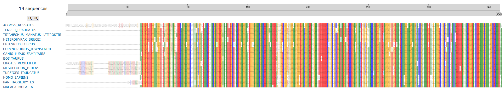{#fig-alineamiento}

### 2.3.2. Análisis de conservación de secuencia

Mediante R se analizó la conservación de cada posición de aminoácidos respecto a la secuencia de la proteína humana. Para cada posición se calculó el porcentaje de secuencias que presentan el mismo aminoácido, considerando los gaps como diferencias.

| Parámetro                        | Resultado |
|----------------------------------|-----------|
| Número de secuencias             | 14        |
| Longitud del alineamiento        | 359       |
| Longitud de la proteína problema | 297       |
| Conservación media (%)           | 91,05     |
| Mediana (%)                      | 100       |
| Desviación estándar              | 20,06     |

: Resumen del análisis de conservación. {#tbl-conservacion}

Las posiciones de aminoácidos se clasificaron según su grado de conservación (@fig-distribucion).

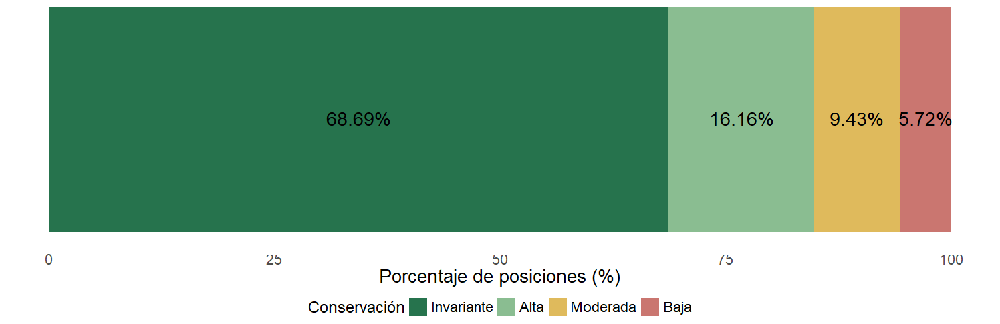{#fig-distribucion width="100%"}

Las proteínas analizadas presentan una conservación media del 91,05 %. De los 297 aminoácidos de la proteína problema, 204 son invariantes y el 84,85 % de las posiciones presentan una conservación igual o superior al 80 %. Esta elevada conservación podría estar relacionada con la importancia de determinados aminoácidos para mantener la estructura y función de la proteína.

```{r}
#| label: calcular-conservacion
conservacion <- data.frame(
  columna = seq_along(ref),
  posicion = cumsum(ref != "-"),
  aa = ref,
  conservacion = colMeans(sweep(aln, 2, ref, "==")) * 100
) |>
  filter(aa != "-")
invariantes <- conservacion |>
  filter(conservacion == 100)
invariantes
```

```{r}
#| label: grafica-conservacion
#| fig-show: hide
ggplot(conservacion, aes(posicion, conservacion)) +
  geom_line(color = "steelblue", linewidth = 0.6) +
  geom_hline(yintercept = 80, linetype = 2) +
  scale_y_continuous(limits = c(0, 100)) +
  labs(
    x = "Posición de aminoácidos",
    y = "Conservación (%)"
  ) +
  theme_minimal()+
  theme(
    axis.title.x = element_text(size = 28),
    axis.title.y = element_text(size = 28),
    axis.text.x = element_text(size = 26),
    axis.text.y = element_text(size = 26)
  )
```

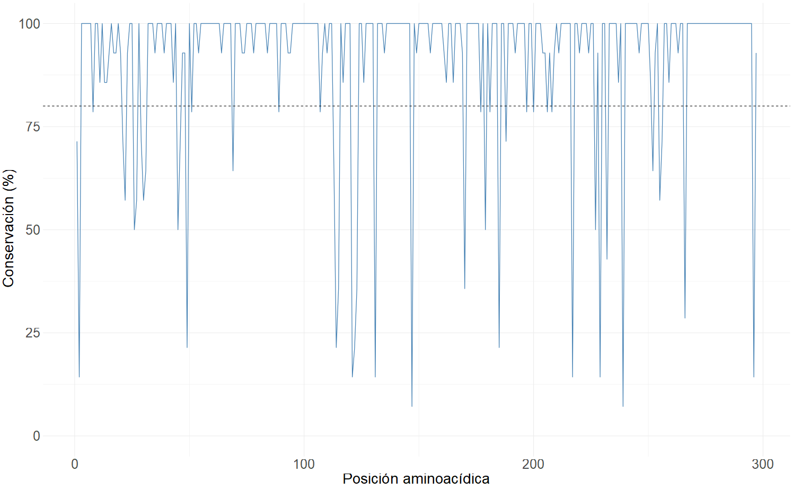{#fig-conservacion}

```{r}
#| label: resumen-conservacion
#| fig-show: hide
resumen <- conservacion |>
  summarise(
    secuencias = nrow(aln),
    longitud_alineamiento = ncol(aln),
    longitud_proteina = n(),
    conservacion_media = mean(conservacion),
    conservacion_mediana = median(conservacion),
    desviacion_estandar = sd(conservacion),
    invariantes = sum(conservacion == 100),
    invariantes_pct = mean(conservacion == 100) * 100,
    alta = sum(conservacion >= 80 & conservacion < 100),
    moderada = sum(conservacion >= 50 & conservacion < 80),
    baja = sum(conservacion < 50)
  ) |>
  mutate(across(where(is.numeric), ~ round(.x, 2)))
resumen
distribucion <- conservacion |>
  mutate(clase = case_when(
    conservacion == 100 ~ "Invariante",
    conservacion >= 80 ~ "Alta",
    conservacion >= 50 ~ "Moderada",
    TRUE ~ "Baja"
  )) |>
  count(clase) |>
  mutate(porcentaje = round(n / sum(n) * 100, 2))
distribucion
distribucion <- distribucion |>
  mutate(clase = factor(clase, levels = c(
    "Invariante", "Alta", "Moderada", "Baja"
  )))
ggplot(distribucion, aes(x = "", y = porcentaje, fill = clase)) +
  geom_col(width = 0.5, position = position_stack(reverse = TRUE)) +
  geom_text(
    aes(label = paste0(porcentaje, "%")),
    position = position_stack(vjust = 0.5, reverse = TRUE),
    size = 10
  ) +
  coord_flip() +
  scale_fill_manual(values = c(
    "Invariante" = "#26734d",
    "Alta" = "#8abd91",
    "Moderada" = "#dfba5c",
    "Baja" = "#ca7670"
  )) +
  labs(x = NULL, y = "Porcentaje de posiciones (%)", fill = "Conservación") +
  theme_minimal() +
  theme(
    axis.text.y = element_blank(),
    axis.text.x = element_text(size = 22),
    axis.title.x = element_text(size = 28),
    axis.title.y = element_blank(),
    legend.position = "bottom",
    legend.title = element_text(size = 24),
    legend.text = element_text(size = 22),
    legend.key.size = unit(1, "cm"),
    panel.grid = element_blank()
  )
```

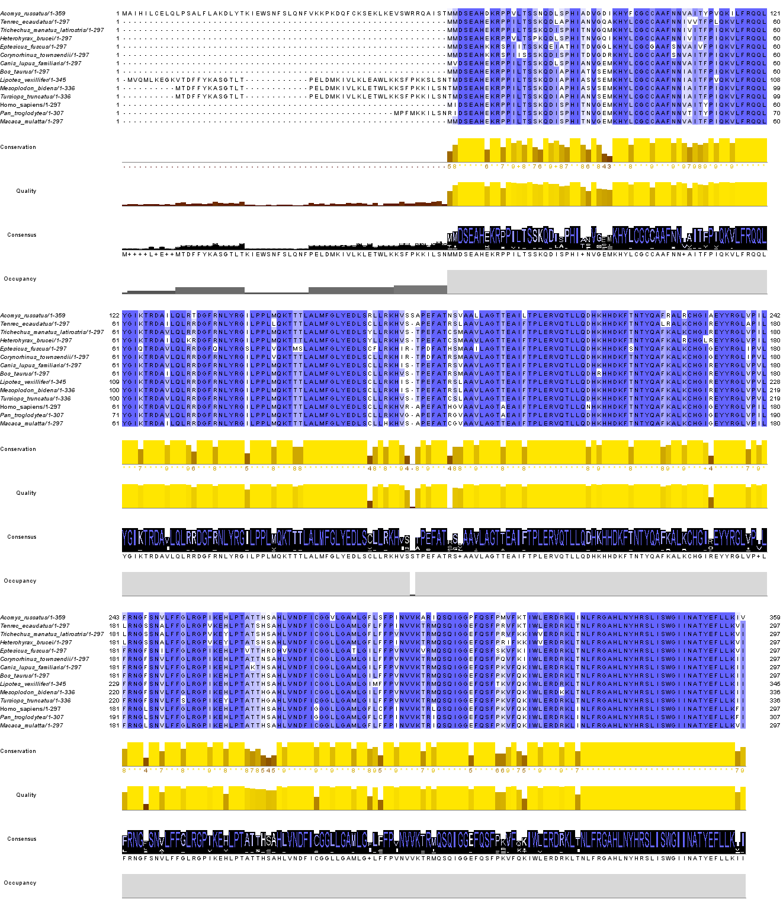{#fig-alineamiento-conservacion}

### 2.3.3. Análisis filogenético mediante máxima verosimilitud

A partir del alineamiento múltiple se generó un árbol filogenético mediante el método de máxima verosimilitud utilizando R. Mediante el criterio BIC se seleccionó el modelo evolutivo JTT+G(4), con cuatro categorías de tasas de sustitución y un parámetro de forma de 0,474, lo que indica una elevada variabilidad de las tasas de sustitución entre las posiciones de aminoácidos [@phangorn2011; @jtt1992].

Para evaluar el soporte de las agrupaciones se realizaron 1000 réplicas de bootstrap, obteniendo valores entre el 34,2 % y el 100 %. Por lo tanto, algunas agrupaciones presentan un mayor soporte que otras. En el árbol filogenético se observa una agrupación de las proteínas que coincide parcialmente con la clasificación taxonómica de los organismos, especialmente en el caso de los primates, cetáceos y murciélagos. Las proteínas de *Acomys russatus* y *Eptesicus fuscus* presentan ramas terminales más largas, lo que indica una mayor divergencia de secuencia.

El árbol obtenido (@fig-filogenia) se exportó en formato Newick y se visualizó mediante iTOL [@itol].

```{r}
#| label: exportar-bootstrap
#| eval: false
library(ape)
library(phangorn)
arbol <- plotBS(fit$tree, bs, type = "none")
arbol$node.label <- round(as.numeric(arbol$node.label)*100, 1)
write.tree(arbol, "data/filogenia_bootstrap.nwk")
```

```{r}
#| label: analisis-filogenetico
#| eval: false
# library(ape)
# library(phangorn)
# set.seed(123)
# # Preparación del alineamiento
# datos <- phyDat(aln, type = "AA")
# # Selección del modelo evolutivo
# modelos <- modelTest(datos, model = c("LG", "WAG", "JTT"), G = TRUE, I = TRUE)
# mejor <- modelos$Model[which.min(modelos$BIC)]
# # Árbol por máxima verosimilitud
# fit <- as.pml(modelos, model = mejor)
# fit <- optim.pml(fit, rearrangement = "stochastic")
# # Bootstrap
# bs <- bootstrap.pml(fit, bs = 1000, optNni = TRUE)
# arbol <- plotBS(fit$tree, bs, type = "none")
# # Resumen
# resumen.filogenia <- data.frame(
#   secuencias = length(arbol$tip.label),
#   longitud_alineamiento = ncol(aln),
#   modelo = mejor,
#   logLik = as.numeric(logLik(fit)),
#   AIC = AIC(fit),
#   BIC = BIC(fit),
#   bootstrap_medio = mean(as.numeric(arbol$node.label), na.rm = TRUE)
# )
# knitr::kable(resumen.filogenia, digits = 2)
# # Identificación de la proteína humana
# arbol
# # Exportación
# write.tree(arbol, "filogenia.nwk")
# getwd()
```

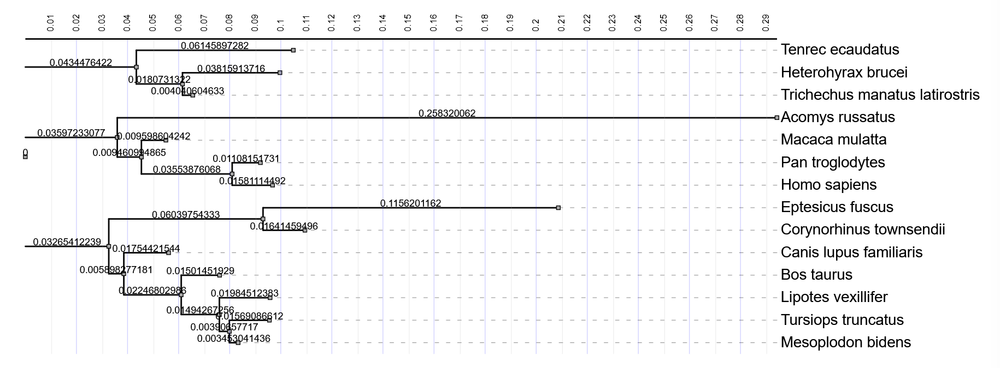{#fig-filogenia}

## 2.4. Predicción de características estructurales

### 2.4.1. Predicción de estructura secundaria

Mediante JPred se realizó una predicción de la estructura secundaria a partir de la secuencia de aminoácidos de la proteína problema [@jpred2015]. En los resultados obtenidos (@fig-jpred) se observa un predominio de hélices α de diferente longitud distribuidas a lo largo de la secuencia. También se observan regiones sin estructura secundaria definida, principalmente en el extremo N-terminal. Los resultados son coherentes con la estructura característica de los transportadores mitocondriales de la familia SLC25.

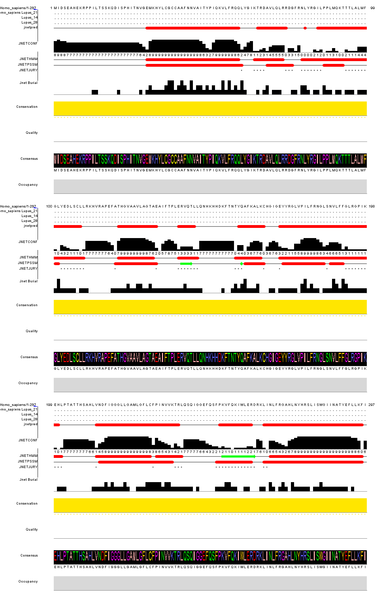{#fig-jpred}

### 2.4.2. Identificación de dominios estructurales y motivos funcionales mediante InterPro y PROSITE

Mediante InterPro se identificó que la proteína problema pertenece a la familia de transportadores mitocondriales de NAD⁺ [@interpro].

| Base de datos | Perfil identificado   |
|---------------|-----------------------|
| PANTHER       | Mito_NAD+\_Carrier    |
| PROSITE       | SOLCAR                |
| Pfam          | Mito_carr             |
| CATH-Gene3D   | MCP_dom_sf            |
| SUPERFAMILY   | Mitochondrial carrier |

: Perfiles de secuencia identificados mediante InterPro. {#tbl-interpro}

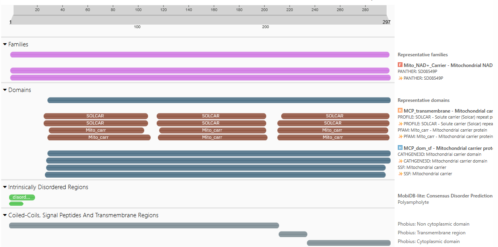{#fig-interpro}

Se identificaron tres regiones repetitivas mediante los perfiles SOLCAR y Mito_carr. Ambos perfiles identifican prácticamente las mismas regiones de la proteína, utilizando diferentes métodos de predicción.

Mediante ScanProsite (@fig-scanprosite) se determinaron las posiciones de las tres regiones SOLCAR correspondientes al perfil PS50920 [@prosite2006; @ps50920].

| Región   | Inicio | Fin | Longitud (aa) | Score  |
|----------|--------|-----|---------------|--------|
| SOLCAR 1 | 28     | 108 | 81            | 13,674 |
| SOLCAR 2 | 116    | 200 | 85            | 15,863 |
| SOLCAR 3 | 213    | 296 | 84            | 10,349 |

: Posiciones de las regiones SOLCAR identificadas mediante ScanProsite. {#tbl-solcar}

Las tres regiones presentan una longitud similar y representan el 84,18 % de la secuencia de aminoácidos. Cada región SOLCAR está constituida típicamente por dos hélices α transmembrana y una hélice α más corta. Las tres regiones forman conjuntamente el dominio estructural del transportador mitocondrial. También se identificó una región con características de desorden intrínseco en el extremo N-terminal.

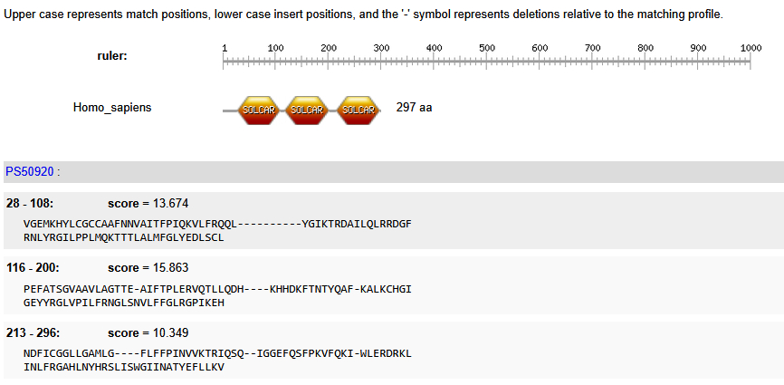{#fig-scanprosite}

### 2.4.3. Predicción de topología transmembrana

Para identificar las regiones transmembrana de la proteína problema se utilizaron Phobius, DeepTMHMM y Phyre2 [@phobius2004; @deeptmhmm; @phyre2015].

Mediante DeepTMHMM se clasificó la proteína como una proteína transmembrana de tipo α-helicoidal. Sin embargo, se identificaron solamente tres segmentos transmembrana, mientras que mediante Phobius se identificó solamente uno.

Mediante Phyre2 (@fig-phyre-topologia) se identificaron seis segmentos transmembrana correspondientes a las posiciones 34–60, 78–101, 123–145, 170–193, 216–237 y 267–290.

Comparando estos resultados con las regiones SOLCAR identificadas anteriormente mediante ScanProsite se observa que cada región contiene dos hélices α transmembrana, lo que coincide con la organización estructural característica de los transportadores mitocondriales de la familia SLC25.

Por lo tanto, la predicción obtenida mediante Phyre2 es la más coherente con los resultados obtenidos mediante InterPro, PROSITE y AlphaFold. Las diferencias entre las predicciones muestran las limitaciones de los diferentes métodos utilizados y la importancia de utilizar varias herramientas para caracterizar la estructura de una proteína.

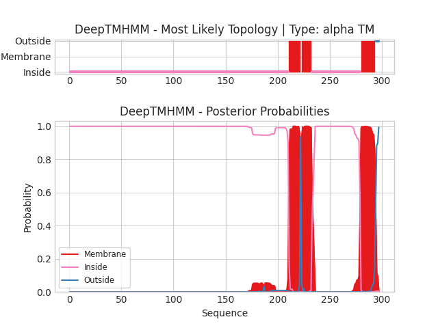{#fig-deeptmhmm}

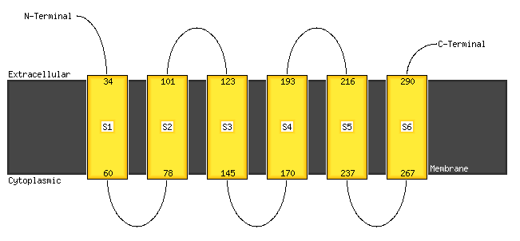{#fig-phyre-topologia}

### 2.4.4. Análisis de conservación de las regiones SOLCAR

A partir de los resultados obtenidos mediante ScanProsite se seleccionaron las posiciones de aminoácidos correspondientes a las tres regiones SOLCAR para analizar su grado de conservación de manera independiente.

```{r}
#| label: conservacion-solcar
#| fig-show: hide
regiones <- conservacion |>
  mutate(region = case_when(
    between(posicion, 28, 108) ~ "SOLCAR 1",
    between(posicion, 116, 200) ~ "SOLCAR 2",
    between(posicion, 213, 296) ~ "SOLCAR 3",
    TRUE ~ "Resto"
  ))
regiones |>
  group_by(region) |>
  summarise(
    longitud = n(),
    media = round(mean(conservacion), 2),
    mediana = median(conservacion),
    sd = round(sd(conservacion), 2),
    invariantes = sum(conservacion == 100),
    porcentaje = round(invariantes / longitud * 100, 2)
  ) |>
  knitr::kable()
ggplot(regiones, aes(region, conservacion, fill = region)) +
  geom_boxplot() +
  scale_fill_manual(values = c(
    "SOLCAR 1" = "cornflowerblue",
    "SOLCAR 2" = "seagreen",
    "SOLCAR 3" = "orange",
    "Resto" = "gray50"
  )) +
  labs(x = "Región", y = "Conservación (%)") +
  theme_minimal() +
  theme(legend.position = "none")
```

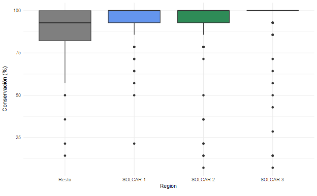{#fig-solcar-conservacion width="85%"}

| Región | Longitud (aa) | Media (%) | Mediana (%) | Desv. estándar | Invariantes | Invariantes (%) |
|-----------|----------:|----------:|----------:|----------:|----------:|----------:|
| SOLCAR 1 | 81 | 94,18 | 100 | 13,32 | 57 | 70,37 |
| SOLCAR 2 | 85 | 90,42 | 100 | 22,47 | 62 | 72,94 |
| SOLCAR 3 | 84 | 91,41 | 100 | 22,00 | 65 | 77,38 |
| Resto | 47 | 86,17 | 92,86 | 21,03 | 20 | 42,55 |

: Conservación de las regiones SOLCAR y del resto de la proteína. {#tbl-solcar-conservacion}

Como se observa en @fig-solcar-conservacion y @tbl-solcar-conservacion, las tres regiones SOLCAR presentan una conservación media superior al 90 %, mientras que el resto de la proteína presenta una conservación media del 86,17 %. SOLCAR 1 presenta la mayor conservación media y la menor desviación estándar, mientras que SOLCAR 3 presenta el mayor porcentaje de aminoácidos invariantes. De los 204 aminoácidos invariantes identificados anteriormente, 184 se encuentran dentro de las regiones SOLCAR, es decir, el 90,20 % de todos los aminoácidos invariantes. En conjunto, el 73,60 % de las posiciones de las regiones SOLCAR son invariantes, frente al 42,55 % del resto de la proteína. La mayor conservación de estas regiones podría estar relacionada con su importancia en el mantenimiento de la estructura tridimensional y la función de la proteína.

## 2.5. Identificación y selección de moldes experimentales

### 2.5.1. Búsqueda de estructuras homólogas mediante BLASTp contra PDB

Mediante BLASTp contra la base de datos PDB se realizó una búsqueda de proteínas homólogas cuya estructura tridimensional se ha determinado experimentalmente. Se identificó el transportador mitocondrial de ADP/ATP 2 de *Saccharomyces cerevisiae* como posible molde para el modelado por homología [@altschul1990; @pdb2000].

| Parámetro              | Resultado                                   |
|------------------------|---------------------------------------------|
| PDB ID                 | [4C9G](https://www.rcsb.org/structure/4C9G) |
| Cadena                 | A                                           |
| Organismo              | *Saccharomyces cerevisiae*                  |
| Longitud               | 318 aa                                      |
| Identidad de secuencia | 24,35 %                                     |
| Cobertura de secuencia | 38 %                                        |
| E-value                | 0,041                                       |
| Método experimental    | Cristalografía de rayos X                   |
| Resolución             | 2,49 Å                                      |

: Resultados de BLASTp contra PDB para 4C9G. {#tbl-blast-pdb}

La identidad y cobertura de secuencia obtenidas son relativamente bajas. Sin embargo, dado que ambas proteínas pertenecen a la familia de transportadores mitocondriales SLC25, se consideró 4C9G como posible molde para el modelado por homología.

### 2.5.2. Búsqueda de moldes mediante SWISS-MODEL

Dada la baja cobertura obtenida mediante BLASTp se realizó una búsqueda adicional de moldes mediante SWISS-MODEL. Se identificaron principalmente estructuras experimentales de la proteína desacoplante mitocondrial UCP1 y de transportadores mitocondriales de ADP/ATP [@swiss2018].

| Molde | Proteína                | GMQE | Identidad (%) | Método  |
|-------|-------------------------|------|---------------|---------|
| 8HBW  | UCP1                    | 0,60 | 22,30         | Cryo-EM |
| 9FZQ  | UCP1                    | 0,60 | 22,22         | Cryo-EM |
| 8HBV  | UCP1                    | 0,59 | 22,30         | Cryo-EM |
| 8G8W  | UCP1                    | 0,59 | 22,22         | Cryo-EM |
| 1OKC  | Transportador ADP/ATP   | 0,58 | 21,51         | Rayos X |
| 2C3E  | Transportador ADP/ATP   | 0,58 | 21,51         | Rayos X |
| 6GCI  | Transportador ADP/ATP   | 0,57 | 20,60         | Rayos X |
| 4C9J  | Transportador ADP/ATP 3 | 0,56 | 20,15         | Rayos X |
| 4C9G  | Transportador ADP/ATP 2 | 0,55 | 20,22         | Rayos X |

: Moldes experimentales identificados mediante SWISS-MODEL. {#tbl-swiss-moldes}

Los moldes con mayor GMQE corresponden a la proteína UCP1. También se identificó el molde 4C9G obtenido anteriormente mediante BLASTp. No se seleccionó como molde la estructura de la propia proteína predicha mediante AlphaFold, dado que el objetivo es realizar el modelado a partir de estructuras determinadas experimentalmente.

### 2.5.3. Comparación estructural de los moldes con AlphaFold

Mediante MatchMaker de ChimeraX se realizó una superposición de las estructuras experimentales 4C9G, 8HBW y 9FZQ con la estructura de la proteína problema predicha mediante AlphaFold. Se utilizó el algoritmo Needleman-Wunsch, la matriz BLOSUM62 y un umbral de exclusión iterativa de 2 Å [@chimerax2021].

| Parámetro                      | 4C9G  | 8HBW  | 9FZQ  |
|--------------------------------|-------|-------|-------|
| Alignment score                | 352,1 | 427,4 | 454,9 |
| Pares alineados                | 249   | 265   | 265   |
| Pares retenidos                | 101   | 104   | 104   |
| RMSD global (Å)                | 7,373 | 6,032 | 5,843 |
| RMSD tras ajuste iterativo (Å) | 1,122 | 1,128 | 1,129 |

: Comparación estructural de los moldes experimentales con AlphaFold. {#tbl-moldes-rmsd}

A pesar de las diferencias en la secuencia primaria se observa una organización tridimensional similar de las hélices α. Considerando todos los pares alineados, el menor RMSD se obtuvo utilizando el molde 9FZQ. Sin embargo, tras la exclusión de los pares con mayor desviación se obtuvo un RMSD similar para los tres moldes. Esto indica la existencia de regiones con una elevada similitud estructural, aunque solamente se retuvo aproximadamente el 40 % de los pares alineados.

Para el modelado por homología se seleccionaron los moldes 8HBW y 9FZQ debido a sus valores de GMQE y su similitud estructural con la proteína problema. También se seleccionó el molde 4C9G identificado anteriormente mediante BLASTp para comparar los resultados obtenidos utilizando dos tipos diferentes de transportadores mitocondriales como molde.

## 2.6. Modelado de la estructura tridimensional

### 2.6.1. Predicción estructural mediante AlphaFold

Mediante AlphaFold se generó una predicción de la estructura tridimensional de la proteína problema. Para evaluar la confianza de la predicción (@fig-plddt) se analizaron los valores de pLDDT correspondientes a los carbonos α de los 297 aminoácidos, obteniendo un valor medio de 74,65 [@alphafold2024].

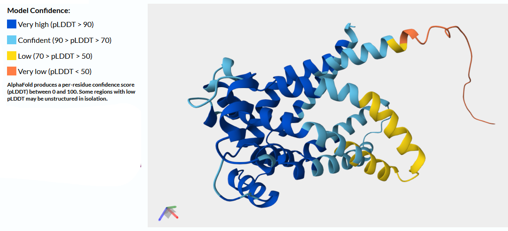{#fig-alphafold}

Las tres regiones SOLCAR presentan valores medios de pLDDT de 78,61, 79,22 y 82,04 respectivamente, mientras que la región N-terminal presenta un valor medio de solamente 32,31. Estos resultados coinciden con la predicción de desorden intrínseco de la región N-terminal obtenida mediante InterPro.

```{r}
#| label: confianza-alphafold
#| fig-show: hide
library(dplyr)
library(ggplot2)
cif <- readLines("models/fold_2026_11_20_01_10_slc25a51_homo_sapiens_model_0.cif")
atomos <- read.table(text = grep("^ATOM[[:space:]]+", cif, value = TRUE), quote = "", comment.char = "")
plddt <- atomos |>
  filter(V4 == "CA") |>
  transmute(posicion = V9, plddt = V15) |>
  mutate(confianza = case_when(
    plddt >= 90 ~ "Muy alta",
    plddt >= 70 ~ "Alta",
    plddt >= 50 ~ "Baja",
    TRUE ~ "Muy baja"
  ))
stopifnot(nrow(plddt) == 297, all(plddt$plddt >= 0 & plddt$plddt <= 100))

ggplot(plddt, aes(posicion, plddt, fill = confianza)) +
  geom_col(width = 1) +
  geom_hline(yintercept = c(50, 70, 90), linetype = 2) +
  scale_fill_manual(values = c(
    "Muy alta" = "#0053D6",
    "Alta" = "#65CBF3",
    "Baja" = "#FFDB13",
    "Muy baja" = "#FF7D45"
  )) +
  scale_y_continuous(limits = c(0, 100)) +
  labs(x = "Posición de aminoácidos", y = "pLDDT", fill = "Confianza") +
  theme_minimal() +
  theme(legend.position = "bottom")
```

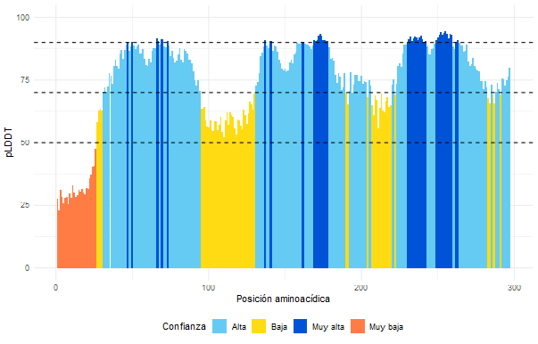{#fig-plddt}

La estructura obtenida presenta una organización predominantemente α-helicoidal con una cavidad central y se utilizó como referencia para comparar los modelos obtenidos mediante modelado por homología.

### 2.6.2. Modelado por homología mediante SWISS-MODEL

Utilizando los tres moldes experimentales seleccionados anteriormente se generaron tres modelos tridimensionales mediante SWISS-MODEL [@swiss2018] (@fig-swiss-modelos).

| Parámetro          | Modelo 01 | Modelo 02 | Modelo 03 |
|--------------------|-----------|-----------|-----------|
| Molde              | 8HBW      | 9FZQ      | 4C9G      |
| Identidad (%)      | 22,30     | 22,22     | 20,22     |
| Cobertura (%)      | 91        | 91        | 90        |
| Región modelada    | 27–297    | 27–297    | 31–294    |
| Estado oligomérico | Monómero  | Monómero  | Monómero  |
| Ligandos           | Ninguno   | Ninguno   | Ninguno   |

: Características de los modelos obtenidos mediante SWISS-MODEL. {#tbl-swiss-modelos}

::: {#fig-swiss-modelos layout-ncol="2"}
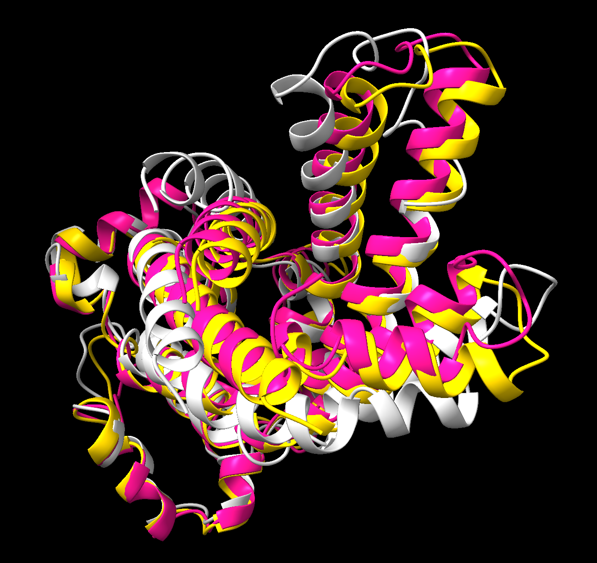

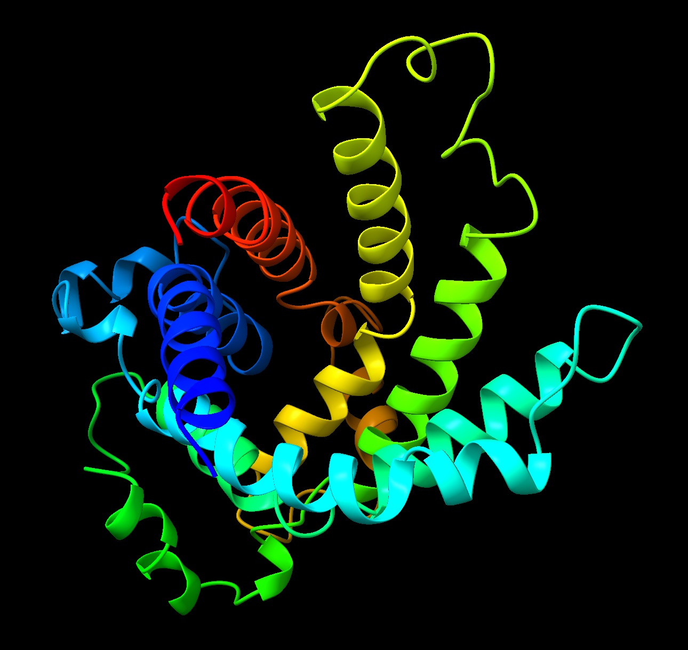

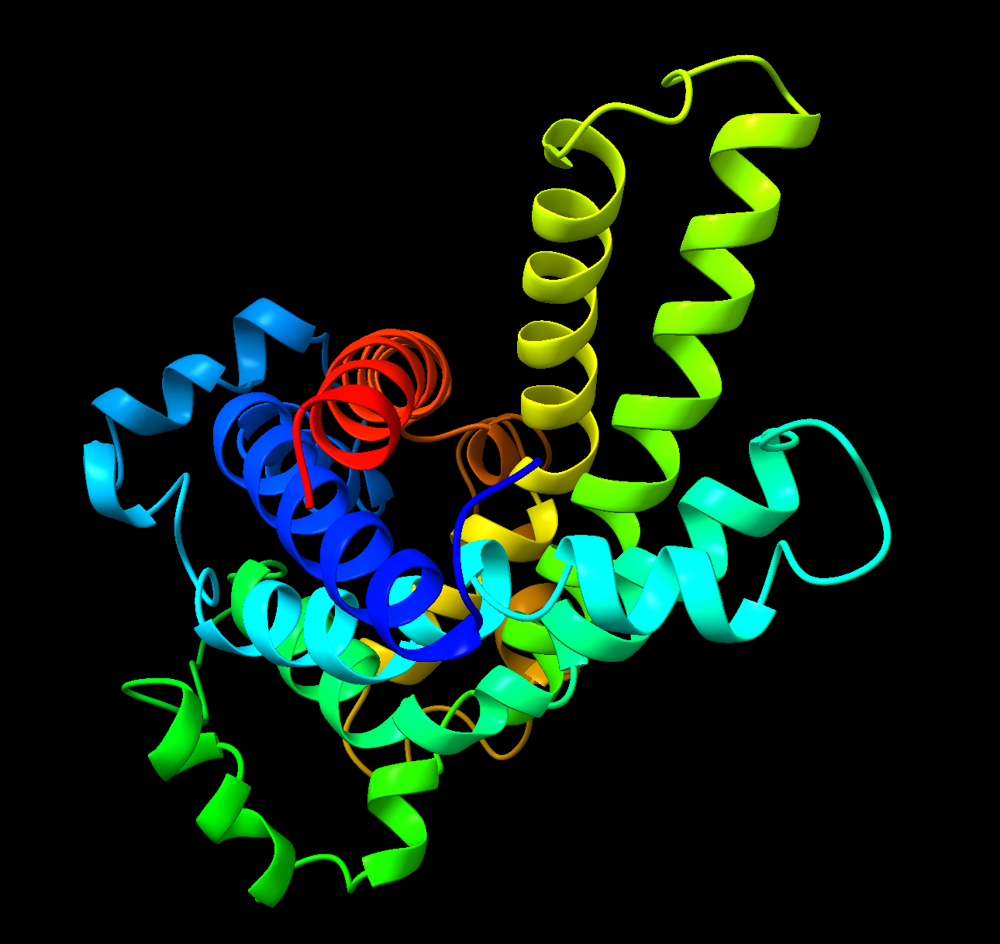

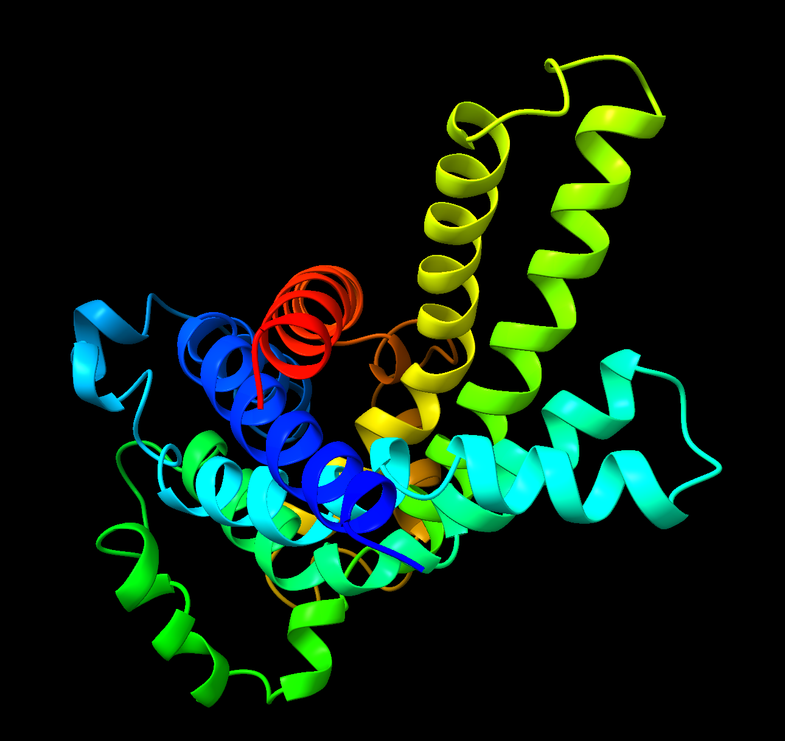

Representación tridimensional y superposición de los modelos obtenidos mediante SWISS-MODEL.
:::

A pesar de la baja identidad de secuencia se consiguió modelar aproximadamente el 90 % de la proteína problema. En los tres modelos queda sin modelar principalmente la región N-terminal. Sin embargo, las tres regiones SOLCAR se encuentran prácticamente completas. Los ligandos presentes en los moldes experimentales no se incorporaron a los modelos debido a la falta de conservación de los sitios de unión según SWISS-MODEL.

### 2.6.3. Modelado por homología mediante Phyre2

Mediante Phyre2 se identificaron diferentes moldes experimentales correspondientes principalmente a las proteínas desacoplantes mitocondriales UCP1 y UCP2 y a los transportadores mitocondriales de ADP/ATP [@phyre2015].

::: {#fig-phyre-modelos layout-ncol="2"}
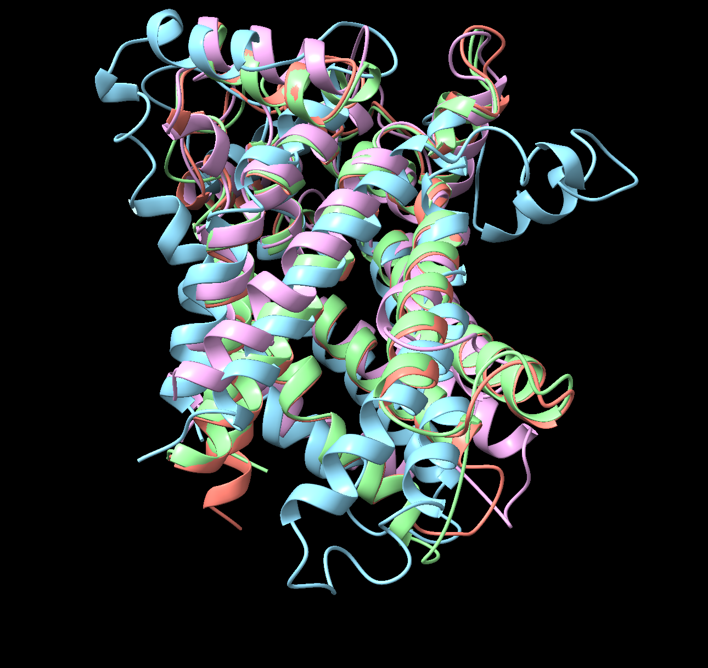

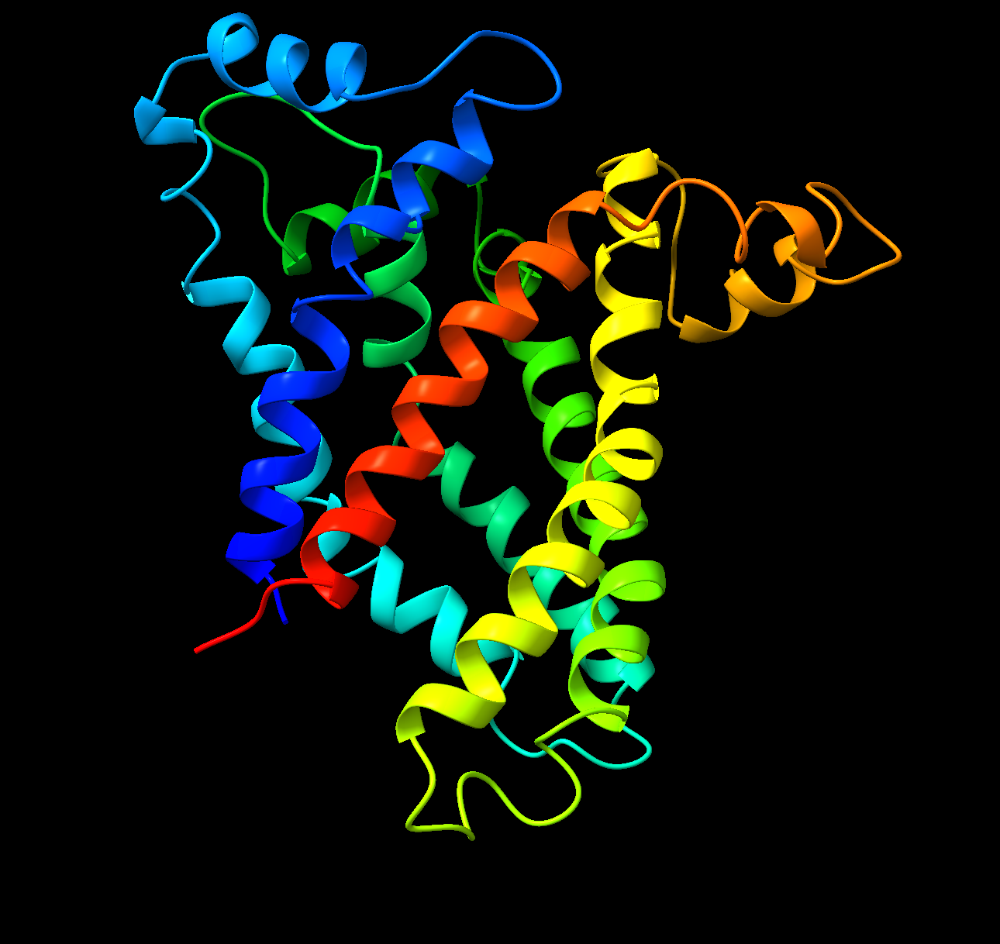

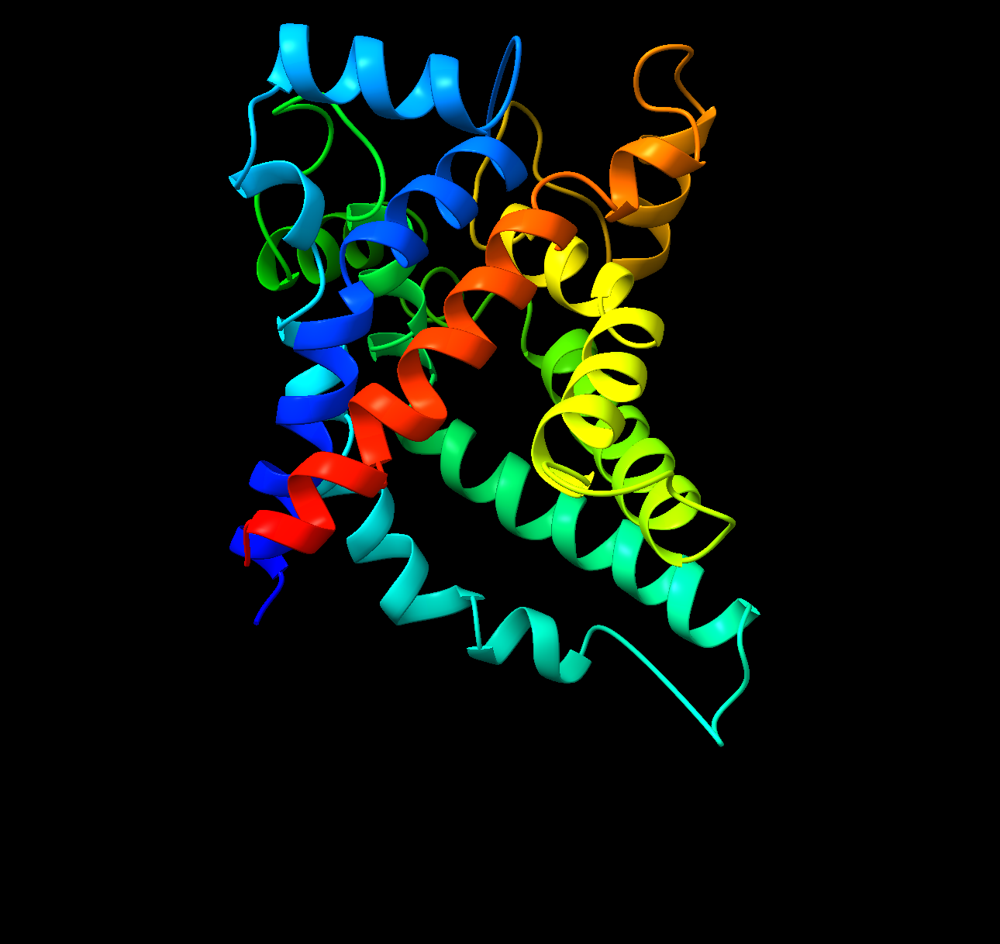

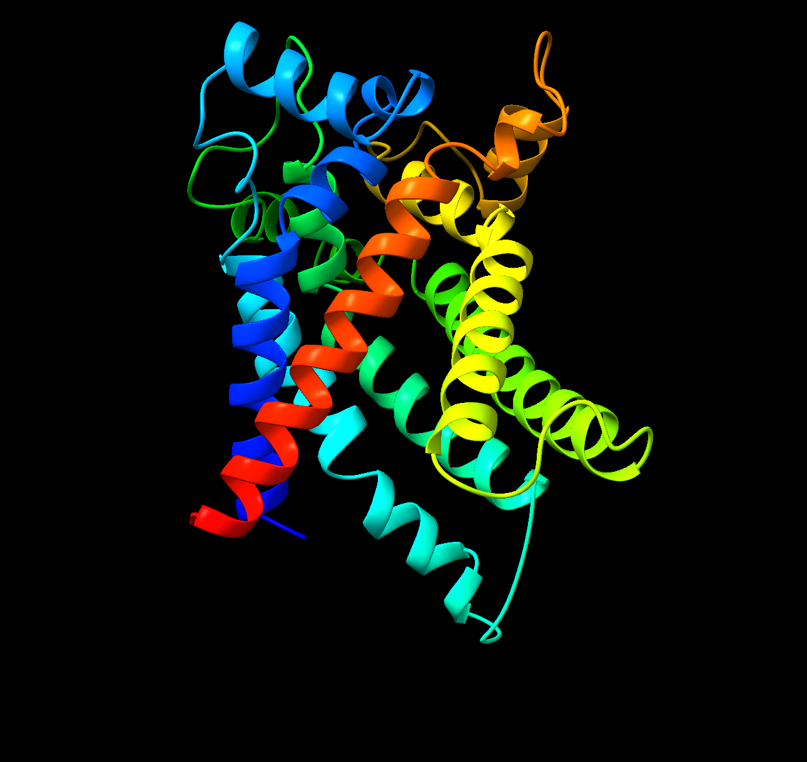

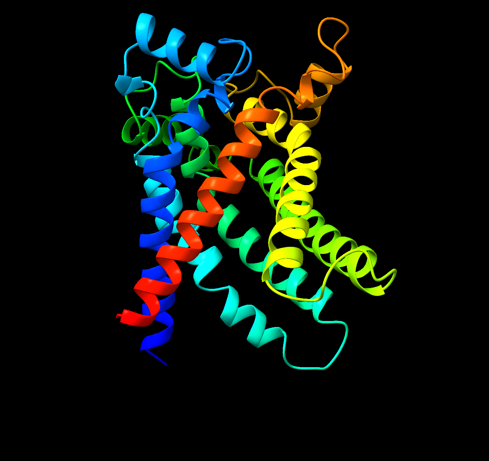

Representación tridimensional y superposición de los modelos obtenidos mediante Phyre2.
:::

Los resultados obtenidos son similares a los obtenidos mediante SWISS-MODEL. Sin embargo, Phyre2 identifica como primer candidato la proteína UCP2 (2LCK), con una identidad de secuencia del 21 %.

Se seleccionaron cuatro moldes para realizar el modelado por homología, tres de ellos utilizados anteriormente mediante SWISS-MODEL, lo que permite comparar ambos métodos utilizando los mismos moldes experimentales. El porcentaje de posiciones alineadas respecto a los 297 aminoácidos de AlphaFold se estimó mediante ChimeraX. No corresponde necesariamente a la cobertura original de Phyre2 (@fig-phyre-modelos).

| Molde | Proteína | Confianza (%) | Identidad (%) | Posiciones alineadas (%) |
|---------------|---------------|--------------:|--------------:|--------------:|
| 2LCK | UCP2 | 100 | 21 | 89,23 |
| 8HBW | UCP1 | 100 | 20 | 90,24 |
| 9FZQ | UCP1 | 100 | 19 | 91,25 |
| 4C9G | Transportador ADP/ATP | 100 | 18 | 83,50 |

: Moldes seleccionados mediante Phyre2. {#tbl-phyre-moldes}

## 2.7. Evaluación y comparación de los modelos tridimensionales

### 2.7.1. Evaluación de calidad mediante GMQE y QMEANDisCo

La calidad de los modelos obtenidos mediante SWISS-MODEL se evaluó utilizando GMQE y QMEANDisCo. Ambos parámetros presentan valores entre 0 y 1, donde un valor próximo a 1 indica una mayor calidad estimada [@swiss2018; @qmean2020].

| Parámetro     | 8HBW        | 9FZQ        | 4C9G        |
|---------------|-------------|-------------|-------------|
| GMQE inicial  | 0,60        | 0,60        | 0,55        |
| GMQE final    | 0,55        | 0,56        | 0,53        |
| QMEANDisCo    | 0,59 ± 0,05 | 0,59 ± 0,05 | 0,55 ± 0,05 |
| QMEAN Z-score | −4,93       | −4,45       | −5,66       |
| Cβ            | −4,26       | −4,24       | −5,47       |
| All Atom      | −1,43       | −1,49       | −1,71       |
| Solvation     | −0,54       | −0,36       | −1,36       |
| Torsion       | −4,22       | −3,76       | −4,46       |

: Evaluación de calidad de los modelos de SWISS-MODEL. {#tbl-swiss-calidad}

Los tres modelos presentan una calidad estructural estimada moderada. Los modelos generados a partir de UCP1 presentan valores de QMEANDisCo ligeramente superiores al modelo generado a partir del transportador de ADP/ATP. Considerando conjuntamente los parámetros analizados, el modelo generado a partir de 9FZQ presenta una calidad estimada ligeramente superior, aunque las diferencias entre los modelos son pequeñas. Los modelos obtenidos mediante Phyre2 se evaluaron adicionalmente mediante el servidor QMEAN utilizando los archivos PDB, lo que permitió comparar la calidad estructural estimada de los modelos obtenidos mediante ambos métodos [@qmean2020].

| Molde |   SWISS-MODEL |        Phyre2 |
|-------|--------------:|--------------:|
| 4C9G  | 0,550 ± 0,050 | 0,486 ± 0,053 |
| 8HBW  | 0,590 ± 0,050 | 0,521 ± 0,051 |
| 9FZQ  | 0,590 ± 0,050 | 0,532 ± 0,051 |
| 2LCK  |             — | 0,433 ± 0,051 |

: Comparación de la calidad estimada mediante QMEANDisCo. {#tbl-qmean-comparacion}

Comparando los mismos moldes (@fig-qmean-comparacion) se observa que SWISS-MODEL presenta valores superiores de QMEANDisCo. El modelo basado en 2LCK presenta la menor calidad estimada, a pesar de la confianza del 100 % en la identificación del molde.

```{r}
#| label: fig-qmean-comparacion
#| fig-cap: "Comparación de QMEANDisCo de los modelos obtenidos mediante SWISS-MODEL y Phyre2."
#| output: true
calidad <- data.frame(
  molde = c("4C9G", "8HBW", "9FZQ", "4C9G", "8HBW", "9FZQ", "2LCK"),
  metodo = c(rep("SWISS-MODEL", 3), rep("Phyre2", 4)),
  QMEANDisCo = c(0.55, 0.59, 0.59, 0.486, 0.521, 0.532, 0.433)
)
ggplot(calidad, aes(molde, QMEANDisCo, fill = metodo)) +
  geom_col(position = position_dodge(0.8), width = 0.7) +
  geom_text(aes(label = round(QMEANDisCo, 2)), position = position_dodge(0.8), vjust = -0.5, size = 4) +
  scale_fill_manual(values = c("SWISS-MODEL" = "steelblue", "Phyre2" = "seagreen")) +
  scale_y_continuous(limits = c(0, 1)) +
  labs(x = "Molde", y = "QMEANDisCo", fill = "Método") +
  theme_minimal() + theme(legend.position = "bottom")
```

### 2.7.2. Comparación estructural mediante ChimeraX y RMSD

**Resultados de Phyre2**

Se utilizó MatchMaker con los mismos parámetros que en la comparación de los moldes experimentales.

| Parámetro                      | 2LCK (#19) | 8HBW (#18) | 9FZQ (#17) | 4C9G (#20) |
|---------------|---------------|---------------|---------------|---------------|
| Alignment score                | 1317,7     | 1340,8     | 1358,0     | 1194,7     |
| Pares alineados                | 265        | 268        | 271        | 248        |
| Pares retenidos                | 37         | 93         | 92         | 102        |
| Pares retenidos (%)            | 13,96      | 34,70      | 33,95      | 41,13      |
| RMSD global (Å)                | 8,737      | 5,707      | 5,850      | 5,627      |
| RMSD tras ajuste iterativo (Å) | 1,371      | 1,106      | 1,126      | 1,123      |
| QMEANDisCo                     | 0,433      | 0,521      | 0,532      | 0,486      |

: Comparación estructural de los modelos Phyre2 mediante MatchMaker. {#tbl-phyre-rmsd}

```{r}
#| label: calcular-rmsd-comunes
#| eval: false
library(bio3d)
library(pwalign)
library(dplyr)
library(ggplot2)
archivos <- c(
  "alphafold.pdb",
  "swiss_8hbw.pdb",
  "swiss_9fzq.pdb",
  "swiss_4c9g.pdb",
  "phyre_9fzq.pdb",
  "phyre_8hbw.pdb",
  "phyre_2lck.pdb",
  "phyre_4c9g.pdb"
)
modelos <- lapply(file.path("models", archivos), read.pdb)
secuencias <- lapply(modelos, function(pdb)
  paste(pdbseq(pdb), collapse = "")
)
# Correspondencia de posiciones respecto a AlphaFold
posiciones <- lapply(secuencias, function(seq) {
  aln <- pairwiseAlignment(secuencias[[1]], seq, type = "global")
  a <- strsplit(as.character(alignedPattern(aln)), "")[[1]]
  b <- strsplit(as.character(alignedSubject(aln)), "")[[1]]
  data.frame(
    referencia = cumsum(a != "-"),
    modelo = cumsum(b != "-")
  )[a != "-" & b != "-", ]
})
# Posiciones presentes en todos los modelos
comunes <- Reduce(intersect, lapply(posiciones, function(x)
  x$referencia
))
# Coordenadas de los carbonos alfa
xyz <- do.call(rbind, lapply(seq_along(modelos), function(i) {
  ca <- atom.select(modelos[[i]], "calpha")
  indices <- posiciones[[i]]$modelo[
    match(comunes, posiciones[[i]]$referencia)
  ]
  as.vector(t(matrix(
    modelos[[i]]$xyz[ca$xyz],
    ncol = 3, byrow = TRUE
  )[indices, , drop = FALSE]))
}))
# Superposicion y calculo de RMSD
ajuste <- fit.xyz(fixed = xyz[1, ], mobile = xyz)
resultados.rmsd <- data.frame(
  modelo = tools::file_path_sans_ext(archivos),
  pares = length(comunes),
  RMSD = apply(ajuste, 1, function(x)
    sqrt(sum((x - xyz[1, ])^2) / length(comunes))
  )
) |>
  filter(modelo != "alphafold") |>
  mutate(RMSD = round(RMSD, 3)) |>
  arrange(RMSD)
knitr::kable(resultados.rmsd)
```

```{r}
#| label: grafica-rmsd-comunes
#| eval: false
resultados.rmsd <- resultados.rmsd |>
  mutate(
    metodo = ifelse(grepl("^swiss", modelo), "SWISS-MODEL", "Phyre2"),
    molde = toupper(sub(".*_", "", modelo))
  )
ggplot(resultados.rmsd, aes(molde, RMSD, fill = metodo)) +
  geom_col(position = position_dodge(0.8), width = 0.7) +
  geom_text(
    aes(label = round(RMSD, 2)),
    position = position_dodge(0.8),
    vjust = -0.5,
    size = 4
  ) +
  scale_fill_manual(values = c(
    "SWISS-MODEL" = "steelblue",
    "Phyre2" = "seagreen"
  )) +
  scale_y_continuous(limits = c(0, 8)) +
  labs(x = "Molde", y = "RMSD (Å)", fill = "Método") +
  theme_minimal() +
  theme(legend.position = "bottom")
```

Para comparar los modelos utilizando las mismas posiciones de aminoácidos se exportaron las estructuras en formato PDB y se procesaron mediante R utilizando bio3d y pwalign. Se identificaron 248 posiciones comunes y se superpusieron los carbonos α sin excluir los pares con mayor desviación [@bio3d2006; @pwalign]. Los resultados se recogen en @tbl-rmsd-comunes.

| Método      | Molde | Pares | RMSD (Å) |
|-------------|-------|------:|---------:|
| SWISS-MODEL | 4C9G  |   248 |    4,316 |
| SWISS-MODEL | 8HBW  |   248 |    4,427 |
| SWISS-MODEL | 9FZQ  |   248 |    4,493 |
| Phyre2      | 8HBW  |   248 |    4,576 |
| Phyre2      | 9FZQ  |   248 |    4,603 |
| Phyre2      | 4C9G  |   248 |    4,783 |
| Phyre2      | 2LCK  |   248 |    7,122 |

: RMSD sobre las 248 posiciones comunes respecto a AlphaFold. {#tbl-rmsd-comunes}

Comparando los resultados obtenidos utilizando las mismas posiciones de aminoácidos (@fig-rmsd-comunes) se observa que los modelos generados mediante SWISS-MODEL presentan un menor RMSD que los modelos generados mediante Phyre2 para los mismos moldes. El modelo generado a partir de 4C9G mediante SWISS-MODEL presenta la mayor similitud estructural respecto a AlphaFold, mientras que el modelo generado a partir de 2LCK mediante Phyre2 presenta la mayor desviación estructural. Estos resultados son coherentes con los obtenidos anteriormente mediante ChimeraX y permiten realizar una comparación más homogénea entre los modelos.

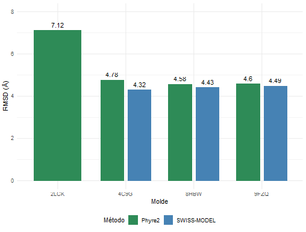{#fig-rmsd-comunes}

**Comparación de todos los modelos**

| Molde | Método | QMEANDisCo | RMSD global (Å) | RMSD iterativo (Å) | Pares retenidos (%) |
|------------|------------|------------|------------|------------|------------|
| 8HBW | SWISS-MODEL | 0,590 | 5,748 | 1,062 | 38,38 |
| 9FZQ | SWISS-MODEL | 0,590 | 5,710 | 1,066 | 36,90 |
| 4C9G | SWISS-MODEL | 0,550 | 5,504 | 1,180 | 48,11 |
| 8HBW | Phyre2 | 0,521 | 5,707 | 1,106 | 34,70 |
| 9FZQ | Phyre2 | 0,532 | 5,850 | 1,126 | 33,95 |
| 4C9G | Phyre2 | 0,486 | 5,627 | 1,123 | 41,13 |
| 2LCK | Phyre2 | 0,433 | 8,737 | 1,371 | 13,96 |

: Comparación de calidad y RMSD de los siete modelos. {#tbl-modelos-comparacion}

### 2.7.3. Selección del modelo por homología

| Criterio                      | Mejor resultado         |
|-------------------------------|-------------------------|
| GMQE                          | SWISS-MODEL 9FZQ        |
| QMEANDisCo                    | SWISS-MODEL 8HBW y 9FZQ |
| RMSD global                   | SWISS-MODEL 4C9G        |
| RMSD iterativo                | SWISS-MODEL 8HBW        |
| Pares retenidos               | SWISS-MODEL 4C9G        |
| RMSD sobre posiciones comunes | SWISS-MODEL 4C9G        |
| Mejor QMEANDisCo de Phyre2    | Phyre2 9FZQ             |

: Selección del modelo según los parámetros evaluados. {#tbl-seleccion}

Considerando conjuntamente los resultados obtenidos mediante GMQE, QMEANDisCo y RMSD, se observa que los modelos generados mediante SWISS-MODEL presentan mayores valores de QMEANDisCo y menores RMSD sobre las posiciones comunes que los generados mediante Phyre2 para los mismos moldes.

El modelo generado a partir de 9FZQ presenta una calidad estructural estimada ligeramente superior según GMQE y QMEAN Z-score, aunque comparte el mismo QMEANDisCo con 8HBW y las incertidumbres se solapan. Por otra parte, el modelo generado a partir de 4C9G presenta una mayor similitud estructural respecto a AlphaFold.

Por lo tanto, se seleccionó el modelo generado mediante SWISS-MODEL utilizando 9FZQ como molde, priorizando los parámetros de calidad estructural estimada frente a la similitud con otra estructura predicha. Esta selección no implica que el modelo sea necesariamente más próximo a la estructura real de la proteína, dado que no disponemos de una estructura experimental de referencia en este análisis.

## 2.8. Relación entre secuencia, estructura y función

### 2.8.1. Organización tridimensional de las regiones SOLCAR

Mediante ChimeraX (@fig-solcar-estructura) se visualizaron las tres regiones SOLCAR identificadas anteriormente, utilizando un color diferente para cada región.

| Región   | Posiciones | Color   |
|----------|------------|---------|
| SOLCAR 1 | 28–108     | Azul    |
| SOLCAR 2 | 116–200    | Verde   |
| SOLCAR 3 | 213–296    | Naranja |

: Regiones SOLCAR representadas mediante ChimeraX. {#tbl-solcar-colores}

Se observa que las tres regiones están constituidas principalmente por hélices α que conjuntamente forman la estructura tridimensional del transportador.

La organización de las tres regiones es coherente con la estructura característica de los transportadores mitocondriales, formada por seis hélices α transmembrana y tres hélices α más cortas.

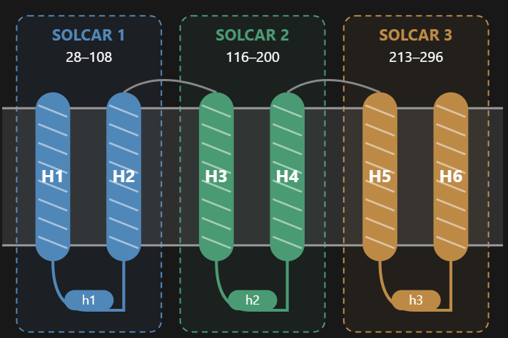{#fig-solcar-esquema}

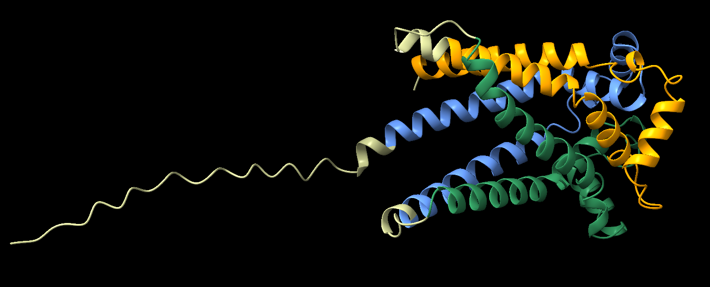{#fig-solcar-estructura}

### 2.8.2. Distribución estructural de los aminoácidos invariantes

Mediante ChimeraX se representaron los 204 aminoácidos invariantes identificados anteriormente sobre la estructura tridimensional predicha mediante AlphaFold. Los aminoácidos invariantes se representaron en naranja y el resto en gris (@fig-invariantes).

Se observa que los aminoácidos invariantes se distribuyen principalmente a lo largo de las hélices α que forman las tres regiones SOLCAR. También se observa una elevada presencia de aminoácidos invariantes en la superficie de la cavidad central del transportador. En el extremo N-terminal se observa una mayor proporción de aminoácidos variables en comparación con la estructura helicoidal. Estos resultados son coherentes con el análisis de conservación realizado anteriormente, donde se determinó que 184 de los 204 aminoácidos invariantes pertenecen a las regiones SOLCAR.

La elevada conservación de los aminoácidos que forman la cavidad central podría estar relacionada tanto con el mantenimiento de la estructura tridimensional como con el reconocimiento y transporte de NAD⁺. Sin embargo, a partir de este análisis no se puede determinar directamente qué aminoácidos participan en la unión del sustrato.

::: {#fig-invariantes layout-ncol="3"}
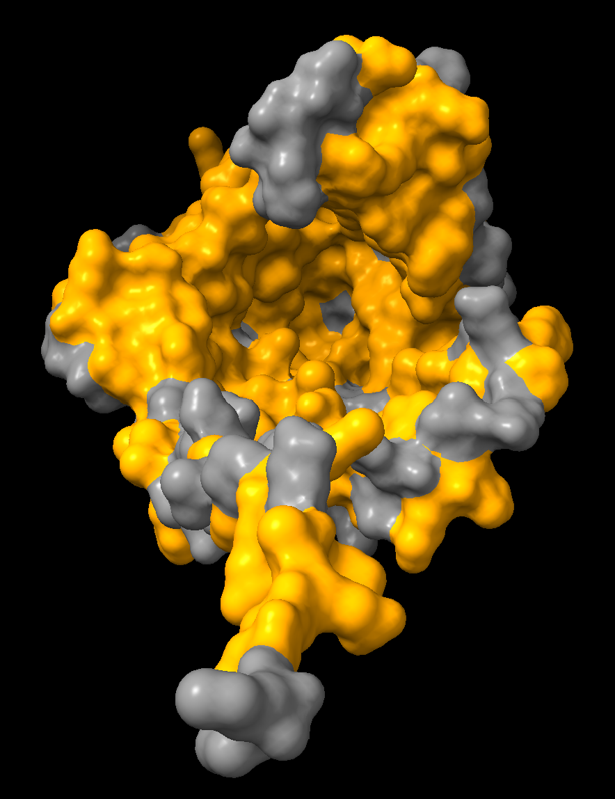{width="100%"}

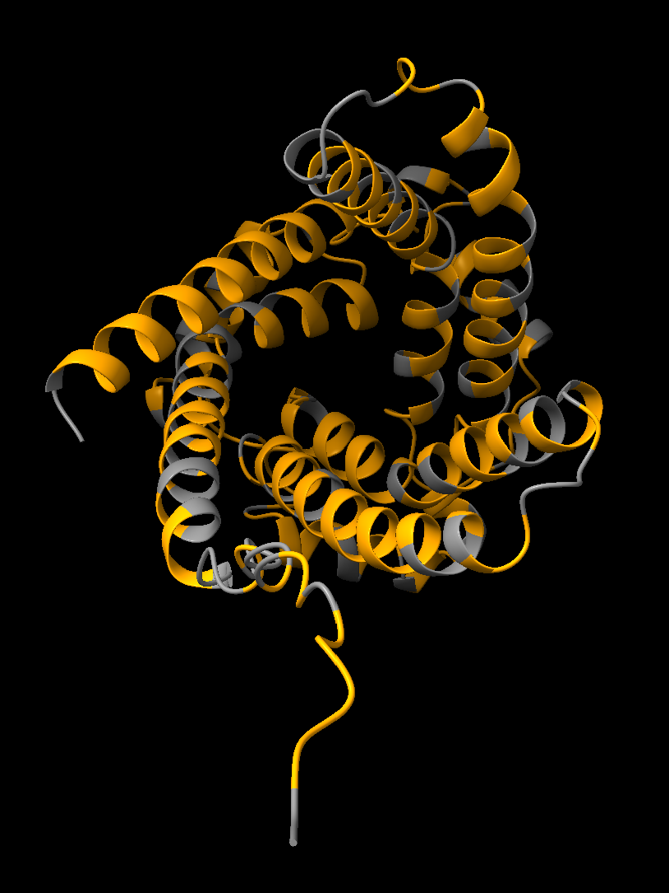{width="100%"}

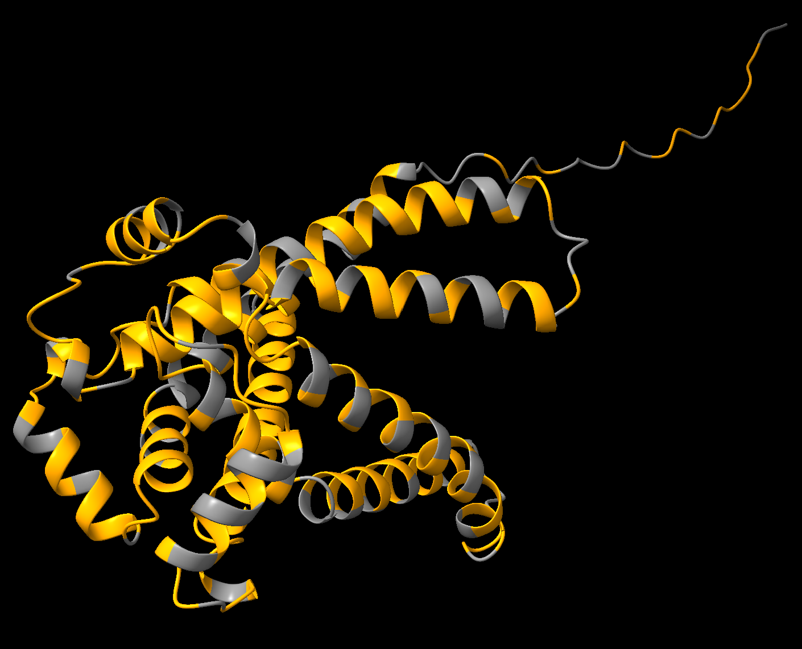{width="100%"}

Distribución de los aminoácidos invariantes (naranja) sobre la estructura de SLC25A51. Los demás residuos se representan en gris.
:::

### 2.8.3. Análisis de la hidrofobicidad de la superficie molecular

Mediante ChimeraX se generó una representación de la superficie molecular de la proteína en función de la hidrofobicidad de los aminoácidos (@fig-hidrofobicidad). Se observa la presencia de regiones hidrófobas en el exterior de la estructura formada por las hélices α. Esta distribución es coherente con el carácter transmembrana de la proteína, dado que permite la interacción con las cadenas hidrocarbonadas de los fosfolípidos de la membrana mitocondrial interna. También se observan regiones hidrófilas que podrían estar orientadas hacia el medio acuoso o hacia el interior del transportador.

::: {#fig-hidrofobicidad layout-ncol="2"}
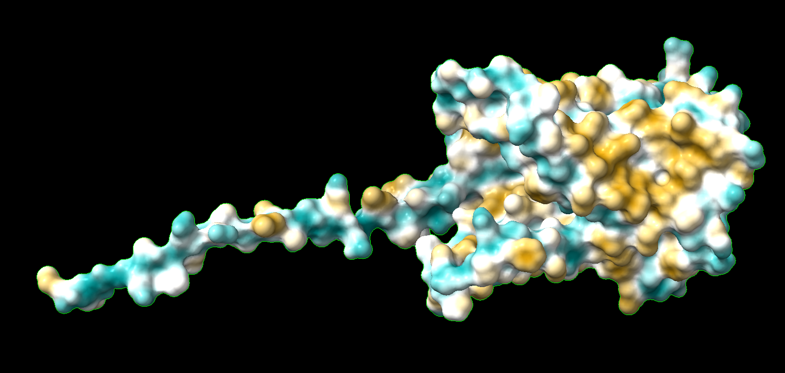{width="100%"}

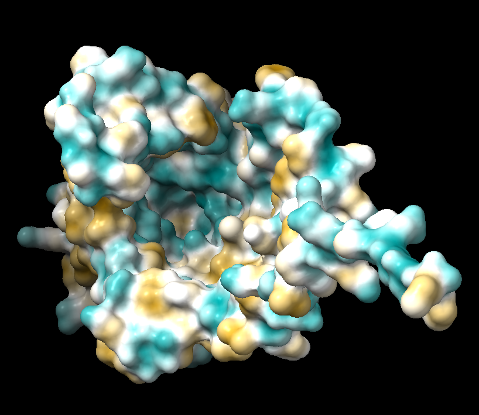{width="100%"}

Superficie molecular de SLC25A51 coloreada según la hidrofobicidad de los aminoácidos (turquesa hidrofilico, amarillo-maron hidrofobico).
:::

### 2.8.4. Características estructurales relacionadas con el transporte de NAD⁺

En la estructura tridimensional se observa una cavidad central, aunque no se observa un túnel continuo que atraviese toda la proteína. Esto es coherente con la función de la proteína como transportador. El mecanismo de acceso alternante característico de esta familia implica cambios conformacionales que permiten exponer el sitio de unión hacia ambos lados de la membrana de forma alternada.

Sin embargo, dado que los modelos obtenidos representan una estructura estática, no se pueden observar directamente los cambios conformacionales relacionados con el transporte de NAD⁺.

# 3. Discusión

Mediante las diferentes herramientas bioinformáticas utilizadas se identificaron características estructurales y funcionales de la proteína SLC25A51. El análisis de conservación muestra una elevada similitud de secuencia entre las proteínas homólogas seleccionadas, especialmente en las regiones SOLCAR, donde se encuentran 184 de los 204 aminoácidos invariantes. Sin embargo, todos los organismos analizados pertenecen a mamíferos, por lo que sería interesante ampliar el análisis utilizando organismos evolutivamente más distantes.

La identificación de tres regiones repetitivas SOLCAR y el predominio de hélices α son coherentes con la estructura característica de los transportadores mitocondriales. Phyre2 identificó seis hélices transmembrana, mientras que DeepTMHMM y Phobius identificaron menos segmentos.

A pesar de la baja identidad de secuencia entre la proteína problema y los moldes experimentales se observa una similitud en la organización tridimensional de las hélices α, lo que indica una conservación parcial de la estructura tridimensional a pesar de las diferencias en la estructura primaria.

Se generaron siete modelos mediante SWISS-MODEL y Phyre2. Los modelos de SWISS-MODEL presentan mayores valores de QMEANDisCo y menores RMSD sobre las 248 posiciones comunes para los mismos moldes. Se seleccionó el modelo basado en 9FZQ por su calidad estimada, aunque 4C9G presenta una mayor similitud respecto a AlphaFold. Esta comparación no permite validar experimentalmente los modelos.

La selección de proteínas homólogas no garantiza que todas sean ortólogas. Además, las diferencias conformacionales entre los moldes y la incertidumbre de AlphaFold pueden contribuir a los valores de RMSD.

La utilización de diferentes herramientas permite obtener información complementaria sobre la estructura de la proteína, aunque ninguna de las predicciones sustituye la determinación experimental de su estructura tridimensional.

# 4. Conclusiones

- Se identificó la proteína problema como el transportador mitocondrial de NAD⁺ SLC25A51

- Se identificaron 204 posiciones de aminoácidos invariantes y una conservación media de secuencia del 91,05 %

- Se identificaron tres regiones repetitivas SOLCAR características de los transportadores mitocondriales

- Se predijo una estructura tridimensional constituida principalmente por hélices α y se identificaron seis posibles segmentos transmembrana mediante Phyre2

- Se generaron siete modelos mediante SWISS-MODEL y Phyre2

- Se seleccionó el modelo de SWISS-MODEL basado en 9FZQ por su calidad estructural estimada

- Las tres regiones SOLCAR contienen 184 de los 204 aminoácidos invariantes

- Se observó una conservación parcial de la estructura tridimensional a pesar de la baja identidad de secuencia con los moldes experimentales

- Se identificaron regiones hidrófobas en la superficie exterior de la proteína, coherentes con su carácter transmembrana

# 5. Bibliografía

::: {#refs}
:::